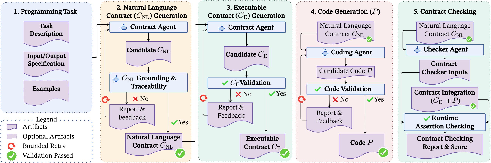
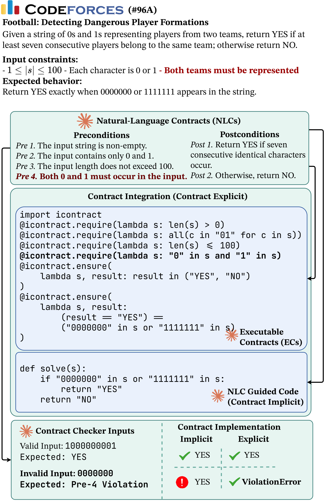
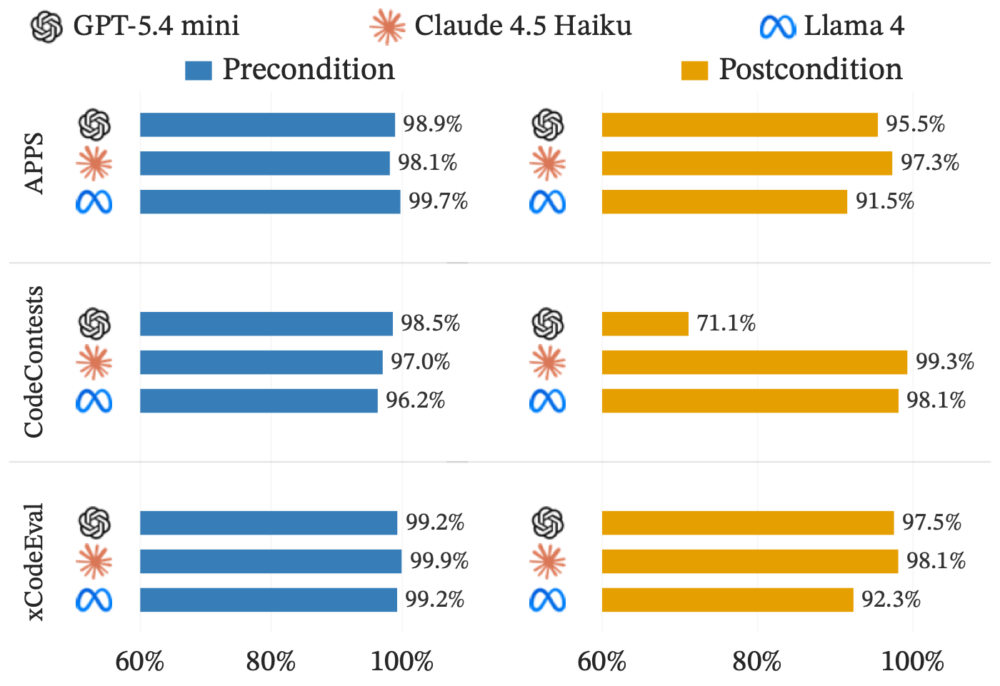
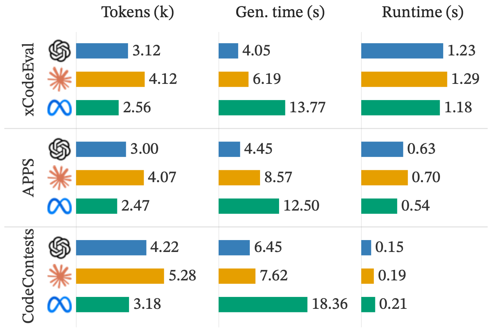
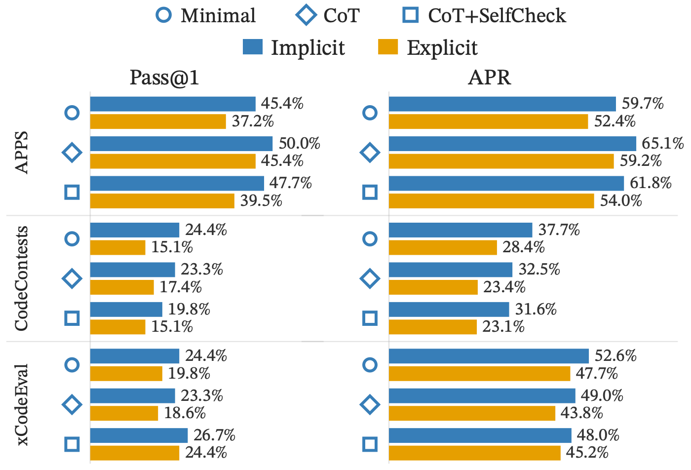

# ContrAct

**Code Generation with Executable Contracts Using Large Language Models**

<p align="center">
  <a href="figures/approach.pdf">
    
  </a>
</p>

ContrAct turns a programming task into natural-language contracts (NLCs),
executable Python contracts (ECs), and generated code. It integrates the ECs with
the code, runs public execution witnesses and generated probes, and evaluates the
result on private benchmark tests. The pipeline retains stage outputs, model
responses, test outcomes, and contract-coverage records for inspection.

This reviewer repository includes the implementation, APPS / Code Contests /
xCodeEval inputs, nine archived model-benchmark result files, and the Football
motivating example. One CLI supports fresh generation, offline readiness checks,
and reproducible mutation testing. Saved-response replay works without API keys;
fresh generation uses the configured model provider.

## Motivating example and results

<table>
  <thead>
    <tr>
      <th width="50%">Football motivating example</th>
      <th width="50%">Experimental results</th>
    </tr>
  </thead>
  <tbody>
    <tr>
      <td width="50%" valign="top">
        <a href="figures/motivatingExample.pdf"></a>
        <p><strong>From requirements to runtime checks.</strong> Football requires both teams to appear in the input. The saved ECs make that requirement executable: the one-team input <code>0000000</code> is rejected by a precondition.</p>
        <p>Both saved variants passed 43/43 private tests. This example demonstrates selected invalid-input enforcement; it does not establish better functional generation or detection of a naturally occurring postcondition fault.</p>
        <p><a href="motivating_example/">Inspect the NLCs, ECs, code, EC + code, and run evidence</a> · <a href="#football-motivating-example">Example details</a></p>
      </td>
      <td width="50%" valign="top">
        <p><strong>Precondition and postcondition correctness</strong></p>
        <a href="figures/correctness.pdf"></a>
        <p><strong>Tokens, generation time, and runtime</strong></p>
        <a href="figures/overhead.pdf"></a>
        <p><strong>Prompt-strategy comparison</strong></p>
        <a href="figures/prompt.pdf"></a>
        <p><a href="#saved-results">Saved result files and model-identity caveat</a></p>
      </td>
    </tr>
  </tbody>
</table>

The figures above are previews of the supplied PDFs; click any image to open its
original. Historical plot labels are retained. See [Saved results](#saved-results)
for the mixed model-identity evidence in the Maverick-labelled run.

## Contents

- [Installation](#installation)
- [Check readiness first](#check-readiness-first)
- [Run the app](#run-the-app)
- [Football motivating example](#football-motivating-example)
- [Mutation testing](#mutation-testing)
- [Files and prompt layout](#files)
- [Saved results](#saved-results)

## Installation

Use Python 3.12, [uv](https://docs.astral.sh/uv/), and Git LFS. Clone the
repository and restore the saved results before running the readiness checks:

```bash
git lfs install
git clone https://github.com/ragibayon/contract-gen.git
cd contract-gen
git lfs pull
python3 results_archive/restore.py
```

Git LFS downloads the benchmark JSONL files and the compressed results archive.
The archive is approximately 385 MB and restores 22 files, including the nine
saved result JSONL files and Football mutation smoke outputs. Restoration
requires about 5 GB of additional disk space. See [Saved results](#saved-results)
for checksum verification and existing-file handling.

Then install the locked dependencies and check readiness:

```bash
uv sync --frozen
uv run --frozen contract --check
```

After the readiness checks pass, configure credentials for generation:

```bash
cp .env.example .env
```

Set `OPENROUTER_API_KEY` in `.env` to run the three named models through OpenRouter.
The `.env` file is excluded from Git. Viewing the saved results does not require
an API key.

## Check readiness first

```bash
uv run --frozen contract --check
```

Run the installation and results-restoration steps above first.

This command runs the repository's offline tests using Python's built-in
`unittest` runner. It does not require `.env`, an API key, the original source
repository, or `logs/`. Network access is blocked in the tests and isolated
replay processes.

The checks cover:

- Python and runtime dependency versions, provider-library imports, CLI entry
  points, and agreement between `pyproject.toml` and `uv.lock`.
- SHA-256 checksums for the 71 frozen input, result, prompt, example, and figure
  files listed in [tests/artifact_manifest.json](tests/artifact_manifest.json).
- Valid JSON, unique task IDs, all 765 benchmark inputs, the 258-task saved
  subset, and all 2,295 saved result records across nine files. Result task IDs
  must match the corresponding benchmark, and historical model evidence must
  match the recorded populations.
- Rendering all 15 prompt templates in both output formats and all four prompt
  variants, checking every stage's template references and package-data paths,
  plus public/private test separation.
- The complete Football pipeline using bundled historical model responses:
  NLC extraction, interface parsing, code parsing, EC parsing, actual contract
  merging, probes, and artifact export. Both resulting programs must pass all
  43 private tests. Six additional executions check the two valid examples and
  the invalid one-team input against the saved programs.
- Actual mutmut enumeration and deterministic selection, a small mutation study,
  reference controls, private-test survivors, and separate timeout/error outcomes.
  These checks use the development dependencies installed by `uv sync --frozen`.

The suite reads about 4.5 GiB of artifacts. Program executions use temporary
directories, wall timeouts, and POSIX CPU/file limits, so the execution checks
require macOS or Linux. New test outputs are temporary; historical artifacts are
not overwritten. No new LLM responses are generated.

Success ends with `READY: offline artifact and pipeline checks passed` and exit
code 0. A failed or skipped check produces `NOT READY` and a nonzero exit code;
the test output identifies the missing file or failed check. Passing confirms
offline readiness, not live API access or the quality of a fresh model response.

The underlying tests can also be run directly:

```bash
uv run --frozen python -m unittest discover -s tests -v
```

## Run the app

Run the CLI without options to generate the Football motivating example from
start to finish:

```bash
uv run contract
```

This selects the bundled xCodeEval 782 input and Claude Haiku 4.5 through
OpenRouter. It generates the natural-language contracts (NLCs), interface, code,
executable contracts (ECs), merged EC + code, and probes, then evaluates the
result on public and private tests. It makes new model requests; it does not
reuse the saved outputs as model responses.

To inspect the default input and settings without model calls:

```bash
uv run contract --dry-run
```

To select a model and example or benchmark interactively:

```bash
uv run contract --interactive
```

You can also specify benchmark options directly:

```bash
uv run contract --model gpt54mini --benchmark apps --limit 1
uv run contract --model haiku45 --benchmark code_contests
uv run contract --model llama4_maverick --benchmark xcodeeval
```

| Model option | OpenRouter model ID |
| --- | --- |
| `gpt54mini` | `openai/gpt-5.4-mini` |
| `haiku45` | `anthropic/claude-haiku-4.5` |
| `llama4_maverick` | `meta-llama/llama-4-maverick` |

Benchmark options are `apps`, `code_contests`, `xcodeeval`, and `all`. Multiple
benchmarks can be selected together. Without `--limit`, explicit commands run
all tasks in each selected benchmark.

```bash
uv run contract --model haiku45 --benchmark apps xcodeeval --limit 5
uv run contract --model gpt54mini --benchmark all --limit 1 --dry-run
```

`--dry-run` validates the dataset files and displays the resolved configuration
without creating output files or making model calls. Actual runs send requests
to the selected provider and execute generated Python programs locally. Public
tests are used during generation; private tests are evaluated afterward.

New benchmark runs write to `results/batch/<model>/<benchmark-selection>/<run-name>/`,
including `results.jsonl`, `run_config.json`, `summary.json`, and task artifacts.
The saved result files directly under `results/` remain separate from new runs.
Console output is displayed in the terminal.

Name a run and resume it later using the same model and benchmark options:

```bash
uv run contract --model gpt54mini --benchmark apps --run-name review
uv run contract --model gpt54mini --benchmark apps --run-name review --resume
```

Use `--retry-failed` with `--resume` to retry records that failed the pipeline.
Other options include `--start`, `--max-tokens`, `--probe-max-tokens`,
`--max-attempts`, `--code-refinement-attempts`, `--timeout`, and `--output-root`.
`--data-dir` selects the directory containing the named benchmark files.
For another model or custom dataset, supply its provider model ID and input path:

```bash
uv run contract --provider ollama --model local-model --dataset path/to/tasks.jsonl
uv run contract --help
```

The same CLI is available as `uv run python -m contract`. No shell launchers are
needed.

## Football motivating example

The default input is Football, Codeforces 96A / xCodeEval problem 782, source UID
`ed9a763362abc6ed40356731f1036b38`. The bundled input is the original row 238
(zero-based) of `data/xCodeEval_update.jsonl`, including its public and private
tests.

| File in `motivating_example/` | Contents |
| --- | --- |
| [xCodeEval_update.json](motivating_example/xCodeEval_update.json) | Single Football benchmark input used by the default command. |
| [problem_statement.txt](motivating_example/problem_statement.txt) | Original task description and requirements. |
| [nlc.json](motivating_example/nlc.json) | Saved natural-language contracts. |
| [interface.py](motivating_example/interface.py) | Saved program interface. |
| [code.py](motivating_example/code.py) | Saved unannotated implementation. |
| [ec.py](motivating_example/ec.py) | Saved executable-contract decorator fragment. |
| [ec_code.py](motivating_example/ec_code.py) | Saved merged code with executable contracts. |
| [contract_lowering_coverage.json](motivating_example/contract_lowering_coverage.json) | Generated NLC-to-EC mapping. |
| [contract_probes.json](motivating_example/contract_probes.json) | Saved probe plan, including its original labels. |
| [public_test_cases.json](motivating_example/public_test_cases.json) | Three original public cases. |
| [runs/haiku_fianl/](motivating_example/runs/haiku_fianl) | Original record, run configuration, evaluation reports, raw stage responses, and input-row provenance. |
| [manifest.json](motivating_example/manifest.json) | Anonymized source locations, hashes, and the input-row extraction description. |

The files above are historical artifacts from `haiku_fianl` with local paths
anonymized. New
generation writes to
`motivating_example/runs/generated/<model>/<run-name>/`, with `nlc.json`,
`interface.py`, `code.py`, `ec.py`, `ec_code.py`, probes, and coverage copied to
the new run directory for inspection. Full records, raw responses, and evaluation
reports are also retained in that run's `artifacts/` directory. If a stage fails,
the run retains the failure record and any available stage artifacts.

```bash
uv run contract --example football --run-name football_review
uv run contract --example football --run-name football_review --resume
uv run contract --example football --model gpt54mini
```

The Football preset uses Haiku 4.5, temperature 0.8, a 2,048-token budget, a
60-second model timeout, and raw model output. These defaults can be overridden
with CLI flags. A fresh generation uses the current pipeline and can differ from
the historical run.

Both saved variants passed 43/43 historical private tests. On valid inputs
`001001` and `1000000001`, both return `NO` and `YES`, respectively. Input
`0000000` violates the requirement that both teams are present: the unannotated
program returns normally, while `ec_code.py` raises an icontract precondition
violation. New bounded local replays of these six program/input combinations
are recorded separately under `motivating_example/runs/offline_validation_*/`.

This example demonstrates selected invalid-input precondition enforcement. It
does not demonstrate a naturally occurring postcondition fault or better
functional generation. Some saved probe cases label one-team inputs as oracles;
those inputs are outside the stated valid domain. The generated resource-bound
NLCs are not enforced as executable contracts.

## Mutation testing

Mutation testing is implemented in
[src/contract/eval/mutation.py](src/contract/eval/mutation.py) and runs locally
without model calls. The locked development environment includes mutmut 3.6.0;
install it with `uv sync --frozen` rather than `--no-dev`.

The default case is the bundled Football implementation and its unchanged ECs.
First inspect the selected mutations without executing programs:

```bash
uv run --frozen contract mutate --prepare-only
```

Run a small example, or use the defaults for up to 10 mutants and all 43 private
cases:

```bash
uv run --frozen contract mutate --max-mutants 2 --max-cases 3
uv run --frozen contract mutate
```

Each invocation creates a new directory under `results/mutations/`. Use
`--output path/to/new-directory` to choose its location; existing directories
are never overwritten. The default mutation pool considers all 15 registered
mutmut operator entries, excludes invalid syntax and AST-identical or duplicate
ASTs, sorts candidates by location and change, and samples without replacement
using `random.Random(42)`. Selection is saved before mutant outcomes are known.
IDs are mutmut library enumeration IDs, not mutmut CLI trampoline IDs.

Choose a different pool, scope, or operator explicitly:

```bash
uv run --frozen contract mutate --list-operators
uv run --frozen contract mutate --pool arithmetic --scope target --prepare-only
uv run --frozen contract mutate --operator operator_number --operator operator_swap_op --seed 42 --max-mutants 5 --prepare-only
```

`--scope all` includes module and caller code. `functions` restricts sites to
function bodies; `target` restricts sites to the body of `--target` (default
`solve`). The arithmetic pool permits only operator substitutions in binary,
unary, and augmented arithmetic expressions, with other structure unchanged;
it does not establish that operands have numeric types. Football may have no
eligible sites under this narrower filter. Contracts and NLCs are never mutation
targets; pass unannotated code as the seed.

To use another task directly from one of the nine saved result files, select its
exact `task_key` and the matching original benchmark dataset:

```bash
uv run --frozen contract mutate \
  --results results/haiku45_xcodeeval.jsonl \
  --task-key XcodeEval/ed9a763362abc6ed40356731f1036b38 \
  --dataset data/xCodeEval_update.jsonl \
  --prepare-only
```

This reads embedded code and ECs rather than old absolute artifact paths and
retains recorded model identity. Alternatively, use `--code`, `--contract`,
`--dataset`, and `--task-index` (zero-based). `--contract` accepts an EC fragment
like `motivating_example/ec.py`, not an entire decorated program.

Before executing mutants, the seed must pass every selected private case.
`--max-cases` uses the first N private cases and records that reduced scope;
omitting it uses all private cases. A seed that fails this gate stops the study
with a nonzero exit code. Private-test survivors are excluded from fault checks;
survival does not establish equivalence. Crashes, timeouts, worker failures, and
unresolved output differences are retained separately and earn no detection
credit.

Only confirmed wrong-output executions are checked with the unchanged ECs.
Automatic oracle certification is limited to the bundled Football identity and
its YES/NO outputs. Other tasks default to `unverified`: mismatches remain
unresolved. Use `--oracle exact` only when the task has a verified unique output
under the benchmark's exact-output comparison, or `--oracle yes-no` for a
verified YES/NO task. No independent reference implementation is supplied by
this workflow: the seed is a private-test-passing generated program.

The same-input original program must also be accepted by the ECs and reach a
postcondition before a mutant's postcondition violation receives
reference-controlled detection credit. Predicate bodies are unchanged; tracing
observes icontract predicate calls and the actual violation exception. Caller
faults, no-postcondition-reach cases, precondition rejection, integration errors,
and contracts that reject the seed remain separate. These are observed outcomes,
not a semantic-recall estimate or a regeneration of the historical mutation study.

Each study contains `config.json`, the copied `seed.py` and `ec.py`, selected
`cases.json`, `selection.json`, mutant sources, unified diffs, `reference.json`,
`reference_controls.json`, per-execution `outcomes.jsonl`, and `summary.json`.
Preparation-only and failed-reference runs contain only the applicable files.
Execution uses isolated child processes, temporary directories, disabled worker
network access, output caps, POSIX resource limits, and process-group wall
timeouts. It requires macOS or Linux and is not an OS security sandbox.

## Files

| Location | Contents |
| --- | --- |
| `figures/` | Original PDF figures and PNG previews embedded above. |
| `src/contract/agent/contract.py` | Pipeline orchestration. |
| `src/contract/agent/stages/` | Specification, interface, code generation, executable contracts, merging, and probes. |
| `src/contract/agent/schema/` | Data models and output parsing. |
| `src/contract/agent/prompts/` | The 15 Jinja templates, grouped by use case as described below. |
| `src/contract/llm/` | Model clients and call metrics. |
| `src/contract/eval/` | Program execution, private tests, and probe evaluation. |
| `src/contract/eval/mutation.py` | Mutmut enumeration, operator/scope selection, deterministic sampling, and mutation execution. |
| `src/contract/eval/_mutation_worker.py` | Bounded program worker and unchanged-predicate tracing. |
| `src/contract/utils/` | Dataset loading, prompt rendering, result persistence, and console reporting. |
| `src/contract/cli.py` | Interactive selection, CLI options, and batch execution. |
| `src/contract/__main__.py` | Entry point for `python -m contract`. |
| `tests/` | Offline checks for the environment, artifacts, CLI, templates, and Football pipeline replay. |
| `tests/artifact_manifest.json` | Frozen file hashes, result provenance, selected source lines, and model populations. |
| `src/contract/readiness.py` | Readiness test runner used by `contract --check`. |
| `motivating_example/` | Football input, historical stage artifacts and runs, and separately saved new generations. |
| `data/apps_specine_update.jsonl` | APPS: 300 tasks. |
| `data/code_contests_update.jsonl` | Code Contests: 165 tasks. |
| `data/xCodeEval_update.jsonl` | xCodeEval: 300 tasks. |
| `data/ablation_258_seed42/` | Saved 86-task subset per benchmark and its original sampling manifest. |
| `data/*_row0.json`, `data/twogram.json` | Small example inputs. |
| `results_archive/` | Lossless results archive, per-file checksums, and restoration script. |
| `results/` | Local files restored from the archive; ignored by Git. New executions use `results/batch/`. |
| `logs/` | Eight archived logs matching the selected runs and two provenance manifests. This directory is local and ignored by Git. |
| `pyproject.toml`, `uv.lock`, `.python-version` | Package configuration, locked dependencies, and Python version. |
| `.env.example` | Environment-variable template. |

Prompts are grouped under `src/contract/agent/prompts/`:

```text
prompts/
  specification/       NLC extraction
  interface/           Program interface generation
  code_generation/     Implementation generation
  executable_contract/ NLC-to-EC translation
  contract_probe/      Probe generation
```

Each directory contains `system.j2`, `user.j2`, and `repair.j2`. Pipeline stages
use paths such as `specification/system.j2`; the shared Jinja loader resolves
them from the prompt root. Readiness tests verify every reference, render every
template in every supported variant/output format, and check that package-data
rules include the grouped files. The reorganization preserves prompt contents
and their existing SHA-256 fingerprints.

## Saved results

Saved results are distributed in the lossless
[`results_archive/results.tar.gz`](results_archive/results.tar.gz) archive via Git LFS.
After cloning, run `git lfs pull` and then:

```bash
python3 results_archive/restore.py
```

The restore command checks every file against the SHA-256 and byte count in
[`results_archive/manifest.json`](results_archive/manifest.json). It refuses to
replace different existing files; pass a separate destination directory as its
first argument if needed. Restored `results/` files remain ignored by Git.
The archive also includes the saved Football mutation smoke outputs.
The filenames below refer to paths created by restoration.

| Historical run | APPS | Code Contests | xCodeEval |
| --- | --- | --- | --- |
| `gpt5.4_mini_final` | `gpt54mini_apps.jsonl` | `gpt54mini_code_contests.jsonl` | `gpt54mini_xcodeeval.jsonl` |
| `haiku_fianl` | `haiku45_apps.jsonl` | `haiku45_code_contests.jsonl` | `haiku45_xcodeeval.jsonl` |
| `smllama4_maverick` | `llama4_maverick_apps.jsonl` | `llama4_maverick_code_contests.jsonl` | `llama4_maverick_xcodeeval.jsonl` |

Each row contains 300 APPS, 165 Code Contests, and 300 xCodeEval records. These
exports keep the last saved record per `task_key` within each historical run,
regardless of success status. The nine files contain 2,295 records in total.
Local filesystem paths in the shared files are anonymized to relative paths.
All other record content is retained; external artifact files referenced by those
paths are not included in the export. `historical/` denotes the external source
archive; `external/`, `runtime/`, and `tmp/` denote anonymous external locations.
Manifest checksums describe the anonymized copies.

The `llama4_maverick` prefix identifies the historical run. Response metadata
reports Llama for 747 tasks, GPT for 15, and no response model for 3. Its run-level
metadata names GPT-5.4 mini. Treat it as a mixed historical population rather than
765 verified Llama outputs.

[tests/artifact_manifest.json](tests/artifact_manifest.json) records source result
files, selected line numbers, counts, model evidence, and SHA-256 hashes. Data
and the compressed saved-results archive are tracked by Git. Supplementary
local logs are excluded from Git and are not needed for readiness tests.
